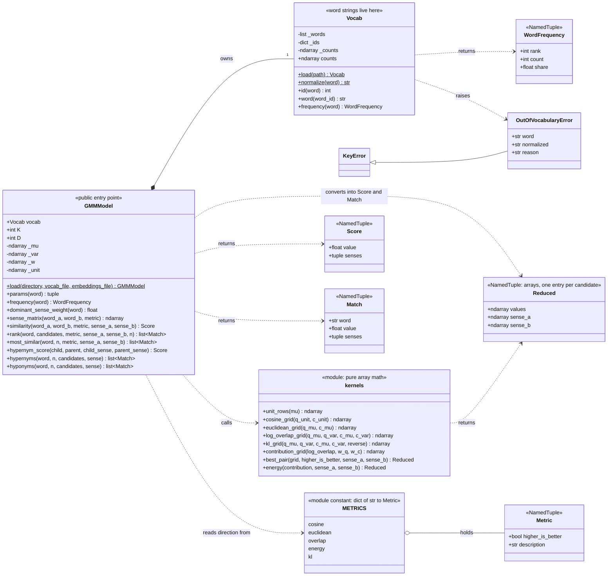

# Class diagram

How the pieces of `gmm_toolkit` relate. `GMMModel` is the only class most callers touch. `kernels` is a module of plain functions rather than a class, shown here with a `module` tag. Private helpers are left out.

## Reading it

- **Solid diamond (`GMMModel` to `Vocab`):** the model holds a vocabulary for its whole lifetime.
- **Dashed arrow:** uses, returns or raises, without keeping a reference.
- **`$` after a method:** a class or static method, called on the class itself, as in `GMMModel.load(...)`.
- **`+` / `-`:** public / private. In the code, private names start with an underscore.

The layering is one-way: `GMMModel` knows about `Vocab` and `kernels`, but neither of those knows about the other or about `GMMModel`. That's what would let a phase 2 torch backend replace `kernels` alone.
